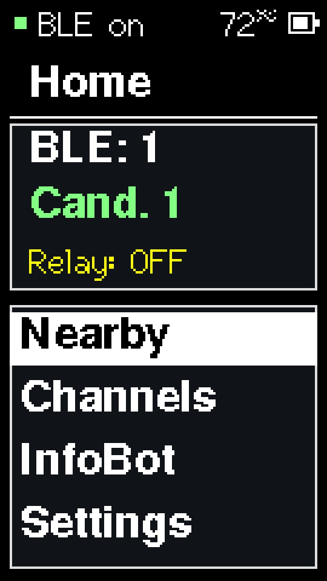
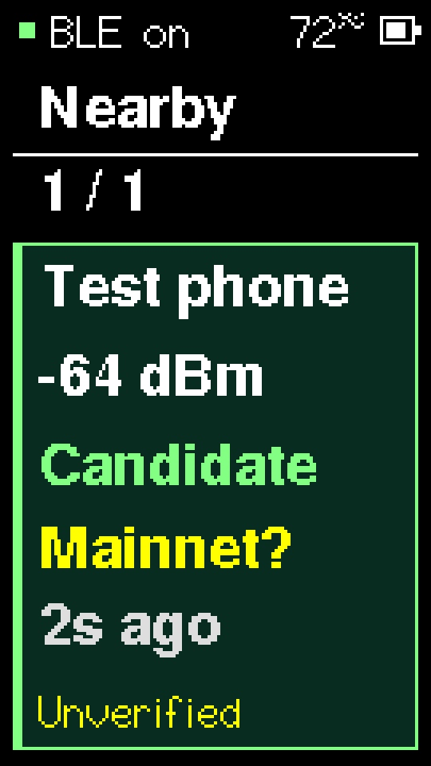
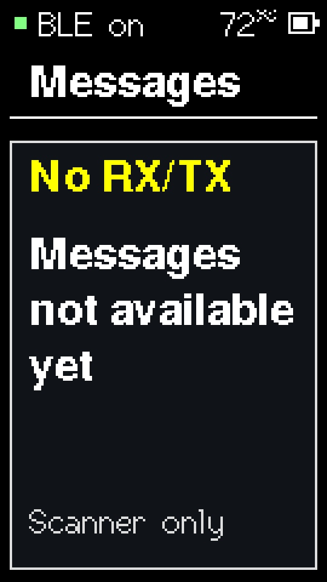
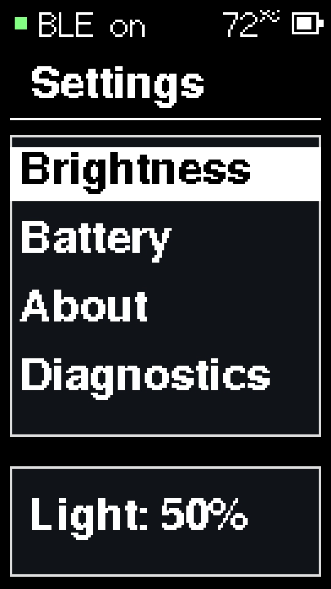

# Screen previews — Bitchat Stick

Default language: **English (en-US)**. These software renders come from the current UI drawing calls, pinned font bitmaps, and simulated observations/battery values. They are not photographs, device screenshots, or evidence of Bitchat messaging compatibility. The lightweight display fake approximates hardware rendering; confirm the final appearance on the Plus2.

Individual JPEGs: 540 × 960 pixels, a 4× nearest-neighbor enlargement of the 135 × 240 layout. The overview is 1880 × 1110 pixels. Text intentionally retains the pixel grid.

The current revision restores grouped panels, the green Nearby card and left border, a live-state header square and battery icon, larger bold text, and high-contrast selection. Regular-screen navigation footers have been removed. Controls appear only on Start: A confirm, B up, C down, hold B back. C-long retains power behavior.

## Overview

## Start

## Home

## Nearby Peers

## Channels

## Messages

## InfoBot

## Settings

## Brightness

## About

The QR box is deliberately a placeholder, not a scannable code. The GitHub address identifies the author's profile, not a verified repository location.
