# Screen previews — Bitchat Stick

Default language: **English (en-US)**. These software renders come from the current UI drawing calls, pinned FreeMono font bitmaps, and simulated observations/battery values. They are not photographs, device screenshots, or evidence of Bitchat messaging compatibility. The lightweight display fake approximates hardware rendering; confirm the final appearance on the Plus2.

Individual JPEGs: 540 × 960 pixels, a 4× nearest-neighbor enlargement of the 135 × 240 layout. The overview is 4480 × 3160 pixels. Text intentionally retains the pixel grid.

The current revision restores grouped panels, the green Nearby card and left border, a live-state header square and battery icon, native 16px bold/14px compact FreeMono text, and high-contrast selection. Regular-screen navigation footers have been removed. Controls appear only on Start: A confirm, B up, C down, hold B back. C-long retains power behavior.

## Overview

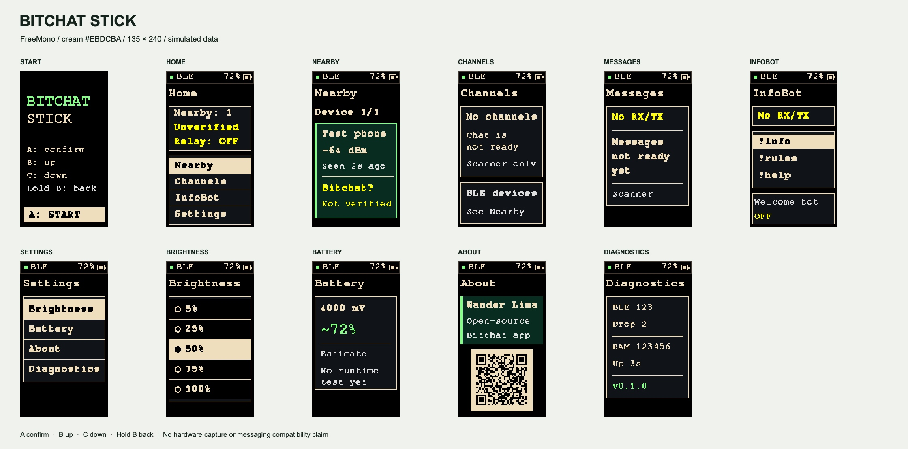

## Start

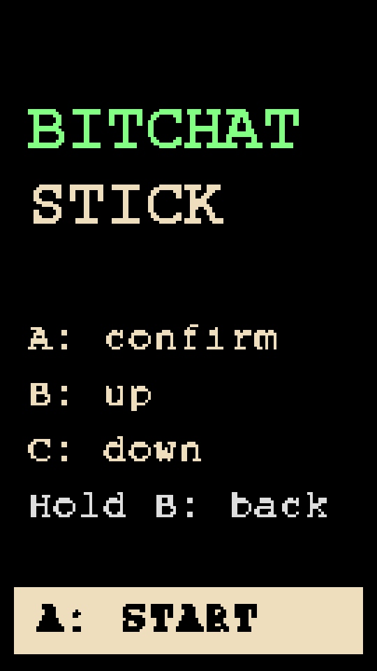

## Home


## Nearby Peers


## Channels


## Messages


## InfoBot


## Settings


## Brightness


## About


The QR points to https://github.com/wanderlima/bitchat-stick. It is generated from the local Figma SVG and has been decoded successfully from the software render. Physical-display camera reading remains to be checked.

Firmware uses FreeMono Regular/Bold. Primary cream is #EBDCBA (RGB565 0xEEF7 on the display). The Figma file uses editable Courier Prime because FreeMono is not available through its font service.

## Battery


## Diagnostics


## Reproduce the renders

Build once with PlatformIO to install the pinned M5GFX font sources. From the root, on macOS with Python 3, a C++ compiler and Swift:

```sh
sh tools/render-device-previews.sh
```

All seventeen views use the actual drawing code. Simulated measurements are confined to the host harness; the firmware never seeds its observation table with mock peers.

## Reproduce exports

After installing the pinned PlatformIO dependencies, run `sh tools/render-device-previews.sh` on macOS. It renders the real UI calls using the test display, simulated observations/battery and synthetic signed peer/public-message traffic, then updates the JPEGs. No message is transmitted and no real identity or conversation is embedded. These previews intentionally do not claim Android/iOS interoperability.

## Sound

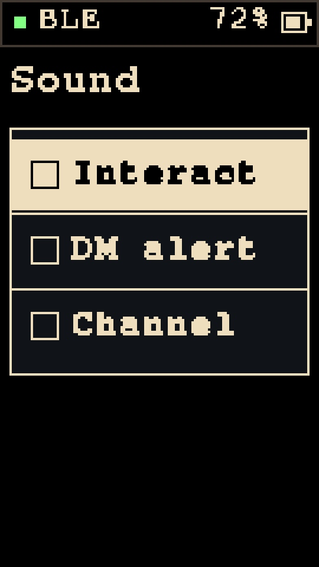

## JoyC HAT

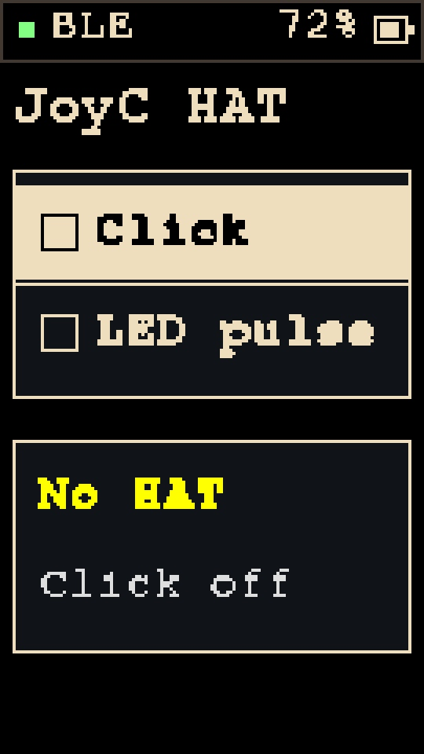

## Private message composer

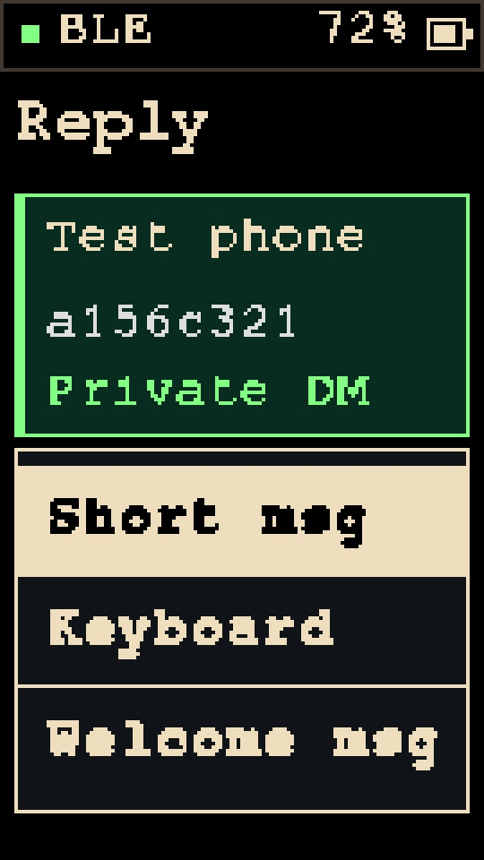

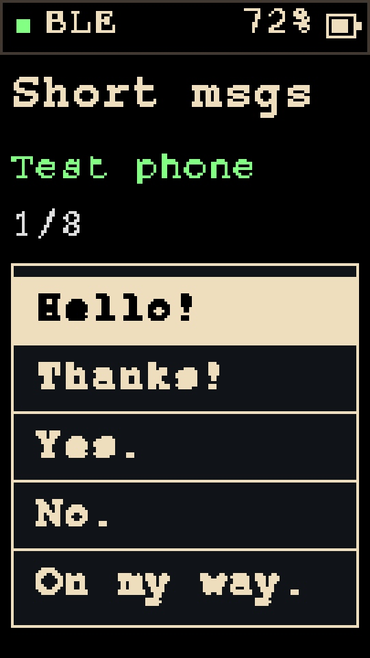

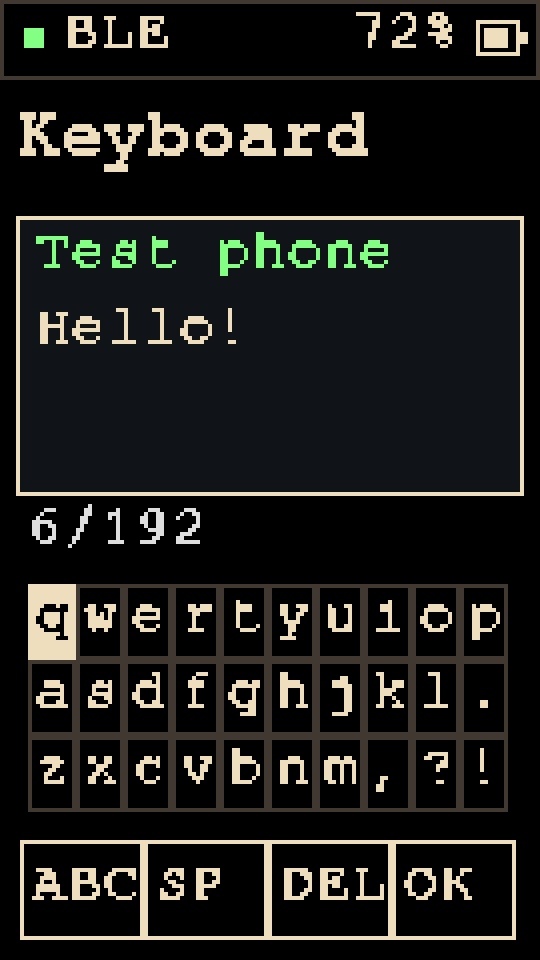

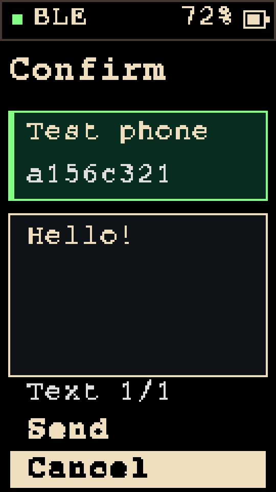

Recipient and draft in these renders are synthetic. The firmware does not seed mock chats. The confirmation preview focuses Cancel, matching entry behavior.

## Public composer states

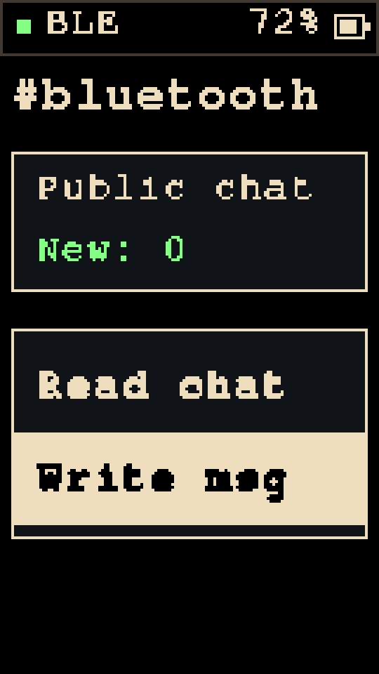

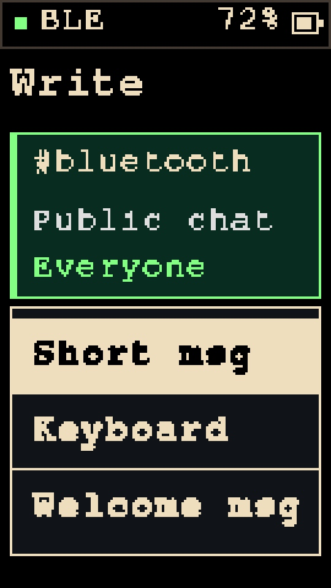

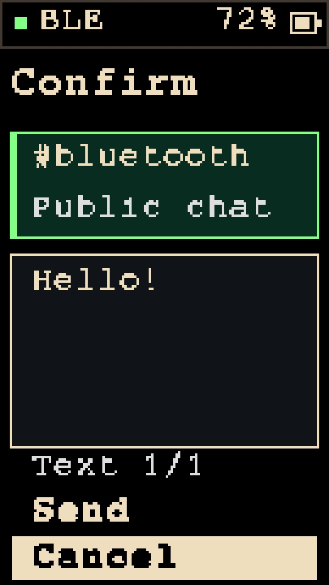

These are additional states of the existing Channels/composer screens, rather than new top-level screens.

The private Reply and public Write previews now show three method choices: Short msg, Keyboard and Welcome msg. Welcome msg reuses the introduction and opens ordinary destination/text confirmation. The related Figma frames were updated with welcome confirmation examples; the neutral About remains a design proposal.
