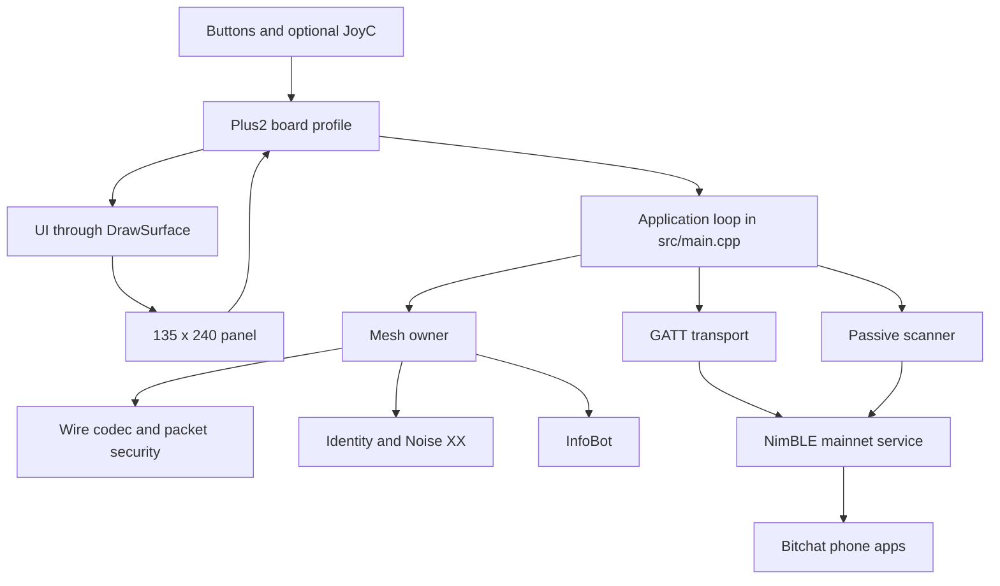

# Architecture

Bitchat Stick is one shared ESP32 core plus a compile-time board profile. The default profile is `m5stickc-plus2`. A second board needs its own profile and its own binary. Headless relay remains proposed; the Plus2 image is not that relay.

## Boot and loop

`src/main.cpp` holds power, starts the board and UI, starts the clock, then starts the scanner and transport. The loop polls the board, drains scanner observations into `PeerTable`, ticks the mesh, polls transport, updates the UI, and honors power-off. Every ten seconds it prints aggregate counters. The log line does not include message bodies or keys.

NimBLE callbacks only enqueue fixed-size events. The application loop is the single owner of `PeerTable` and mesh mutation. The UI reads snapshots. BLE callbacks do not draw.

## Module map

| Path | Responsibility |
| --- | --- |
| `src/main.cpp` | Init order and the single owner loop |
| `src/boards/m5stickc-plus2/` | GPIO hold, M5 init, Plus2 guard, RTC, buttons, battery, speaker, display, JoyC polling |
| `src/Ui.cpp` | Screens and navigation. Draws only through `include/DrawSurface.h` |
| `src/NavigationInput.h` | A/B/C semantics, long-press suppression, wake suppression |
| `src/Scanner.cpp` | UUID-filtered passive scan and a bounded observation queue |
| `src/Transport.cpp` | Peripheral GATT, two subscribed links, notify fragmentation, outbound queue |
| `src/Mesh.cpp` | Peers, public and DM history, Noise binding, public relay, InfoBot dispatch |
| `src/Identity.cpp` | Versioned NVS identity. Private keys are not shown or logged |
| `src/NoiseSession.cpp` | Noise XX sessions, bounded independently of the two GATT links |
| `src/WireCodec.cpp` | Allocation-free v1/v2 frame views |
| `src/PacketSecurity.cpp` | Signatures, freshness, and bounded raw DEFLATE expansion |
| `src/FragmentAssembler.cpp` | At most two assemblies |
| `src/InfoBot.h` | Command matching and reply strings |
| `src/Settings.cpp` | Brightness and checkbox preferences |
| `src/Joyc.cpp`, `src/Feedback.cpp` | Optional HAT axes, click, LED, and beeps |
| `include/BoardProfile.h` | Capability flags. A display requires input. A HAT requires input |

`build_src_filter` compiles `src/boards/m5stickc-plus2/*` and excludes other board directories. `-DSTICK_BOARD_M5STICKC_PLUS2` selects that profile.

## Radio path

Phones initiate the BLE connection. The Stick advertises the Bitchat mainnet service and scans for the same UUID. A service match is not authentication.

Inbound writes are copied into a 12-event queue of 512-byte payloads. The mesh validates the frame, verifies authenticity where the packet type requires it, deduplicates, and only then updates history or considers public relay. Unknown or oversized input is rejected. Verified public announcements and text may be forwarded with a lower TTL, excluding the ingress link. Private plaintext is not given to InfoBot as a public message. Arbitrary encrypted-DM routing is not implemented.

Outbound frames sit in six 4096-byte slots and are notified at a paced interval, split to the peer MTU when needed.

## Budgets

These are local engineering limits, not upstream protocol constants.

| Resource | Limit |
| --- | --- |
| Observations | 32 entries; the oldest is replaced |
| Observation queue | 32 fixed-size events |
| Subscribed peripheral links | 2 |
| Inbound events | 12 × 512 bytes |
| Outbound frames | 6 × 4096 bytes |
| Private session records | 12 |
| Signed peer records | 12 |
| Visible history | 12 messages shared across public, private, and outgoing; 192 rendered bytes each |
| Deduplication | 64 packet identities |
| Fragment assemblies | 2, with a 30-second lifetime |
| Complete frame / payload caps in the embedded codec | 4096 / 2048 bytes |
| First-DM introductions remembered | 32 identities for the current boot |

Display truncation does not truncate the outgoing packet. Drafts are capped at 192 ASCII characters before send. Do not copy a phone app's memory quotas into the MCU.

The receive path validates the envelope, enforces those limits, verifies authenticity where the packet type requires it, classifies the destination, deduplicates by packet identity, and only then forwards eligible public traffic or delivers it to the UI. Unknown bytes are rejected. Peer state moves from observed, to a compatible service, to connected, to a verified identity, to a session when one is required, and then to disconnected or expired. Radio proximity, multi-hop reachability, and channel membership are different facts.

The bot must not change the power mode on its own. Reducing scan duty changes discovery latency, so a future change has to be measured. An identity reset, if added later, needs an explicit local confirmation because the key changes.

## Persistence and power

Brightness, sound and JoyC checkboxes, and the local identity are versioned NVS records. Observations, messages, unread state, peer pins, and the Bot ON/OFF switch are RAM-only. Bot returns to ON after reboot. Identity keys live in unencrypted NVS. No secure-boot or flash-encryption provisioning is part of this project.

The screen can turn off while scanning continues. Deep sleep would stop the radio, so the Plus2 profile does not use sleep as a messaging power mode. Button C remains the power button: a 6-second hold keeps the power-off behavior, and a long C press is never a down action on release.

## Website

The site is a static Astro project. HTML is prerendered. GSAP and Three.js load in the browser for motion and the hardware walkthrough. Content, FAQ, and documentation links remain in the static HTML without JavaScript. No website action sends a BLE packet or a firmware command.

## Related Documentation

- [Features](features.md)
- [BLE and command interface](api.md)
- [ADR-0001](adr/adr-0001-shared-core-and-board-profiles.md)
- [Wire contract](wire-contract.md)
- [Adding a board](adding-a-board.md)
- [Adding a display](adding-a-display.md)
